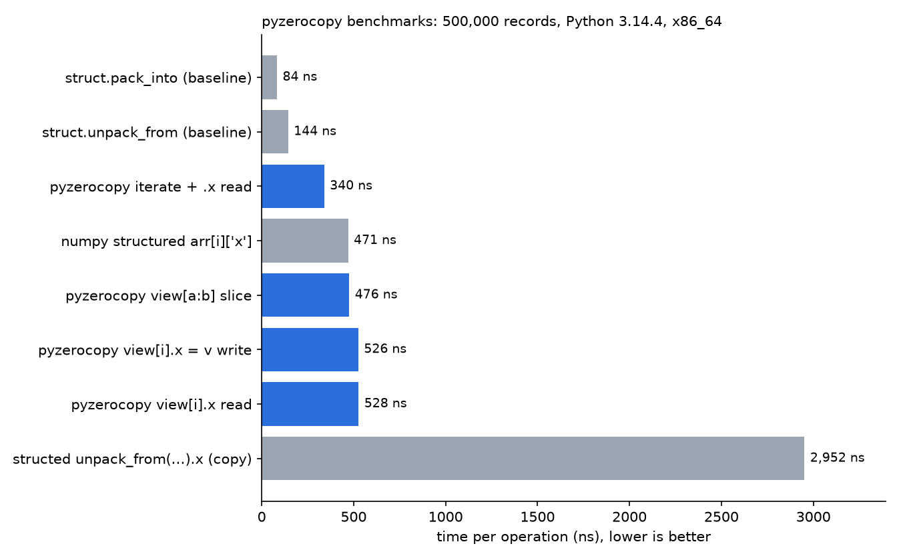

# pyzerocopy

Zero-copy structured buffers for Python.

You describe a binary layout as a class. pyzerocopy then reads and writes its fields directly in memory you already
have: a `bytearray`, an `mmap`, shared memory, a NumPy array. Nothing is copied when you create a view, index into
it, or slice it.

```python
from pyzerocopy import Struct, Endian, float32, uint32_t


class Particle(Struct, endian=Endian.LITTLE):
    x: float32
    y: float32
    id: uint32_t


data = bytearray(Particle.sizeof() * 1000)
particles = Particle.view(data)  # no copy
particles[0].x = 10.5  # writes into `data`
subset = particles[10:100]  # still the same memory
blob = subset.to_bytes()  # copies the bytes
```

## Install

```bash
pip install pyzerocopy
```

Python 3.10 or newer. No dependencies.

## Why

`struct.unpack` gives you a copy of every record you touch. NumPy structured arrays avoid that but pull in a big
dependency and don't give you attribute-style records. pyzerocopy is a small pure-Python layer that does one thing:
named, typed access to bytes where they already live.

## Declaring layouts

Fields are class annotations.

| Kind | Examples |
| --- | --- |
| Integers | `uint8_t`, `uint16_t`, `uint32_t`, `uint64_t`, `int8_t` ... `int64_t` |
| Floats | `float32`, `float64` |
| Fixed arrays | `uint8_t * 4`, `Array(4, uint16_t)`, `Annotated[list[int], Array(4, uint16_t)]` |
| Nested structs | another `Struct` subclass used as the annotation |

Class options:

- `endian=` one of `Endian.LITTLE` (default), `BIG`, `NATIVE`, `NETWORK`. Nested structs keep their own byte order.
- `packed=` `True` (default) puts fields back to back. `False` follows natural C alignment, with padding.

```python
class Header(Struct, endian=Endian.BIG, packed=False):
    version: uint8_t
    length: uint32_t  # lands at offset 4 because packed=False
    tags: uint8_t * 4
```

## Working with views

```python
view = Particle.view(buf)  # whole buffer
view = Particle.view(mm, offset=16, count=100)  # skip a header, take 100 records

len(view)  # number of records
view[3]  # a record proxy, not a copy
view[-1]  # negative indexes work
view[10:100]  # another View over the same memory
for rec in view:
    ...
view.memory  # the underlying memoryview
```

A record is a small proxy holding the memoryview and an offset. Reading `rec.x` unpacks one value from the buffer
and returns a normal Python number. Array fields and nested structs return views, not copies:

```python
rec.tags[2] = 7  # writes in place
rec.tags = [1, 2, 3, 4]  # element-wise assignment, length must match
rec.inner.b = 5  # nested struct, still in place
```

### Errors

| Situation | Exception |
| --- | --- |
| Value out of range or wrong type | `PackingError` (a `ValueError`) |
| Write through read-only memory (`bytes`, read-only `mmap`) | `ReadOnlyError` (a `TypeError`) |
| Index out of range | `IndexError` |
| Bad `offset`/`count`, or length not a whole number of records | `ValueError` |

All library errors inherit from `PyZeroCopyError`.

### Memory and lifetime

- A view keeps its buffer alive. While a view exists, a `bytearray` can't be resized, which is what stops records
  from pointing at freed memory.
- If you release the memoryview yourself, later access raises `ValueError` instead of crashing.
- Don't mutate a buffer from several threads at once without your own locking.

## Performance



Run `make bench` to reproduce this chart on your machine (it rewrites `docs/benchmark.png`; `N=` sets the record
count). The chart above is one run on Python 3.14 with 500k records.

- Reading or writing a field through a record costs about 500 ns, roughly 3 to 4x raw `struct` calls with
  hand-computed offsets. That is the price of named fields.
- Iterating is faster than indexing (about 340 ns per record) because it skips the index checks.
- Against structed, which copies and decodes the whole record on each access, pyzerocopy is about 5x faster per
  field read.
- Creating a view or a slice takes microseconds regardless of buffer size.

Treat the figures as ballpark and measure on your own hardware.

## Limits

- No strided slices (`view[::2]`).
- No string or variable-length fields yet.
- Assigning a whole array is not atomic: if one element is invalid, earlier ones are already written.

## Development

```bash
git clone https://github.com/Zikithezikit/pyzerocopy
cd pyzerocopy
make venv    # create .venv and install dev tools
make check   # lint, type check, tests (what CI runs)
make help    # all commands
```

See [CONTRIBUTING.md](CONTRIBUTING.md) for more.

## License

MIT, see [LICENSE](LICENSE).
